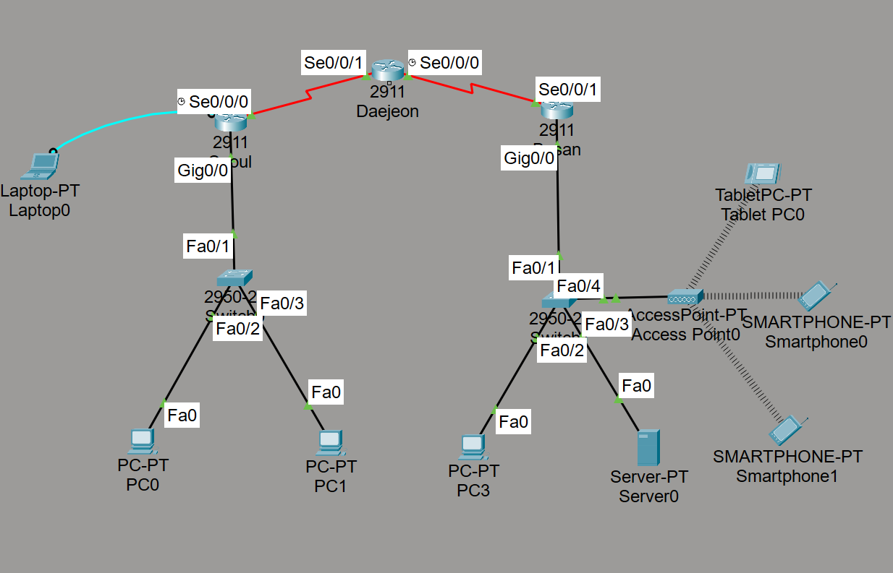
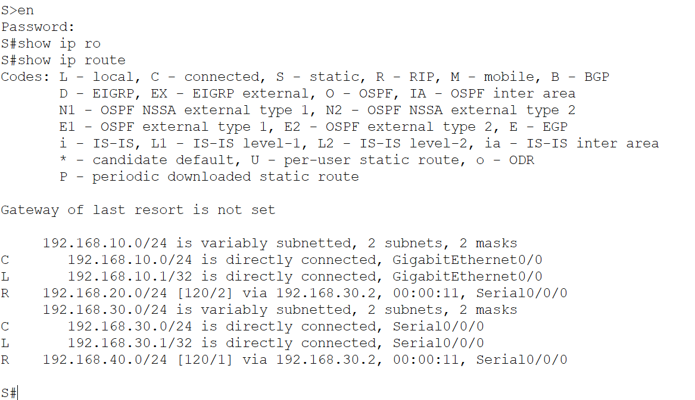
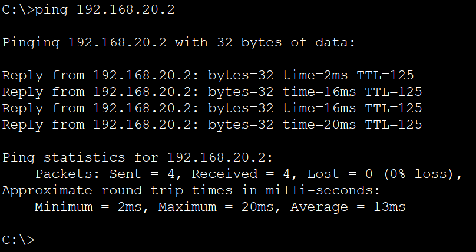
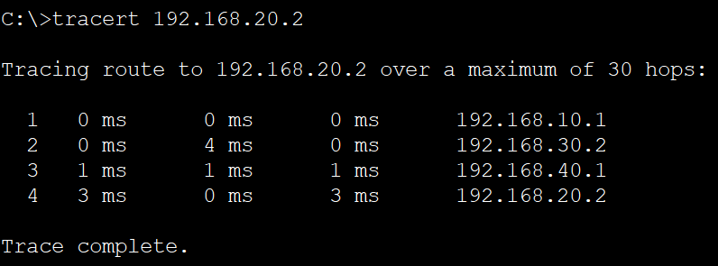

# 지사 간 네트워크 구축

## 전체 네트워크 구성도

### 실습 환경
- Cisco Packet Tracer

### 라우팅 테이블 확인
- 실습 명령어 `show ip route`
- 확인 내용: 서울 라우터에서 RIP로 학습한 네트워크와 Next Hop을 확인했다.
- 배운 점: 라우팅 경로가 존재하더라도 실제 PC 간 통신이 반드시 보장되는 것은 아니다.

### 서울 라우터 라우팅 테이블

#### 라우팅 테이블 분석 결과
- C는 라우터에 직접 연결된 네트워크를 의미하고, R은 다른 라우터로부터 RIP를 통해 학습한 네트워크 경로를 의미한다.
- Next Hop: 서울 라우터는 부산 LAN으로 패킷을 전달하기 위해 Serial0/0/0 인터페이스를 사용하며, 다음 경유지인 대전 라우터(192.168.30.2)로 패킷을 전달한다.
- Metric은 목적지 네트워크까지의 경로 비용을 의미하며, RIP에서는 홉 수를 사용한다. 서울 라우터에서 부산 LAN까지의 RIP Metric은 2이다.

## PC 간 통신 검증

### 서울 PC → 부산 PC ping 테스트

#### ping 테스트 분석 결과
- 출발지: 서울 PC0 (192.168.10.2)
- 목적지: 부산 PC3 (192.168.20.2)
- 두 PC는 서로 다른 네트워크에 속하므로 라우터를 통해 통신한다.
- ping 테스트 결과: 패킷 4개를 전송하고 4개의 응답을 수신했다.
- 패킷 손실률: 0%
- 검증 결과: 서울 PC0와 부산 PC3 사이의 ICMP 왕복 통신이 정산적으로 이루어지는 것을 확인했다.
- 다만 ping 테스트 성공만으로 HTTP나 DNS 등 다른 서비스의 정상 동작까지 보장할 수는 없다.

### 서울 PC → 부산 PC Tracert 테스트

#### Tracert 테스트 분석 결과
- 실행 명령어: tracert 192.168.20.2
- 이동 경로: 서울 라우터 (192.168.10.1) → 대전 라우터 (192.168.30.2) → 부산 라우터 (192.168.40.1) → 부산 PC3 (192.168.20.2)
- 검증 결과: tracert 명령어를 통해 서울 PC0에서 부산 PC3까지 패킷이 이동할 떄 거치는 라우터의 IP 주소와 이동 경로를 확인할 수 있었다.
